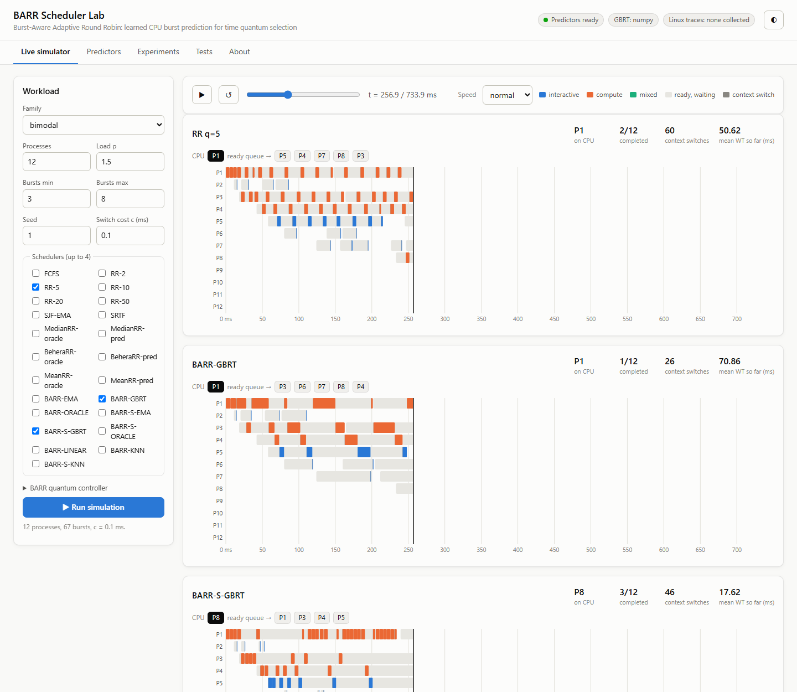
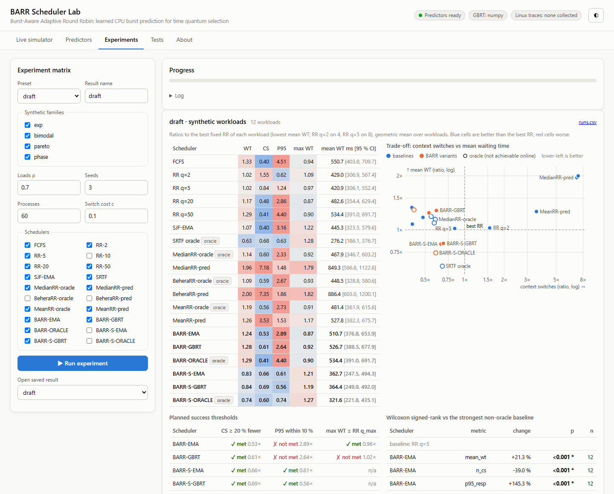
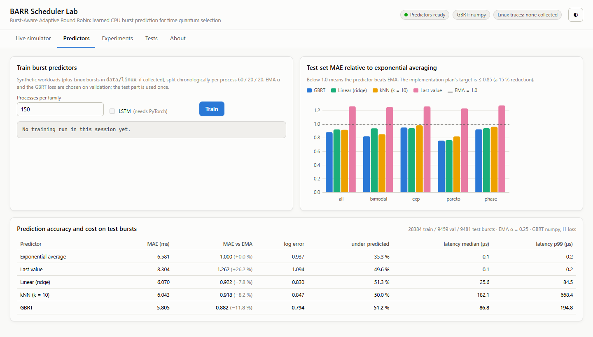

# BARR: Burst-Aware Adaptive Round Robin

**Learned CPU burst prediction for time quantum selection: a trace driven simulator, 20 schedulers, burst predictors and a live dashboard.**

Round robin scheduling depends on a single fixed time quantum. Dynamic quantum
algorithms adapt the quantum, but they assume the burst time of every process is
known in advance, which no real operating system knows. BARR predicts each
process's next CPU burst from its own execution history and turns the prediction
into a bounded per-process quantum. BARR-S uses the same prediction to decide
*which* process runs next.



---

## Highlights

- **Discrete event simulator.** One CPU and one ready queue, with a context switch cost charged on every change of process. The scheduler interface is shared by every policy.
- **20 schedulers.**
  - Classical: FCFS and fixed RR (q = 2 to 50 ms).
  - Shortest-job: SJF with exponential averaging, and SRTF (oracle).
  - Dynamic quantum RR, each in *oracle* and *predicted* mode: Matarneh (median), Behera (median + reordering) and Noon (mean).
  - Proposed: BARR and BARR-S, each with an EMA, learned or oracle predictor.
- **Burst predictors.** Exponential average, last value, ridge, kNN, gradient boosted trees (built-in NumPy implementation, or XGBoost when installed) and an optional LSTM. All are evaluated on a chronological 60 / 20 / 20 split, with latency measured.
- **Workloads.** Synthetic families (exponential, bimodal, Pareto heavy tail, phase change) with Poisson arrivals at load ρ. There is also an ftrace collection and burst extraction pipeline for real Linux traces.
- **Evaluation.**
  - Every metric from the plan: WT, TAT, response time and its 95th percentile, context switches, slowdown, Jain index, first-quantum share.
  - Ratios to the best fixed RR, 95 % bootstrap confidence intervals and exact Wilcoxon signed-rank tests.
  - Checks against the success thresholds fixed before any result was produced.
- **Live dashboard.** Watch schedulers play back side by side, train predictors, and run the experiment matrix and the test suite, all from the browser.
- **66 tests.** Textbook Gantt examples, engine invariants, a cross-check against an independent RR loop, the ftrace parser, feature leakage and the BARR ≡ RR(q_max) equivalence.

## Quick start

```bash
git clone https://github.com/Kunal-Srivastava1911/barr-scheduler.git
cd barr-scheduler
python -m pip install -r requirements.txt     # only numpy (+ pytest) is required
python -m dashboard                           # opens http://127.0.0.1:8765
```

On Windows you can also double-click `run_dashboard.bat`. The first start trains
the burst predictors in the background (about 20 s) and caches them in `models/`.

## Dashboard

| Tab | What it does |
|---|---|
| **Live simulator** | Generate a workload and run up to four schedulers on it. Gantt charts, ready queues, context switches and waiting time play back live. Hover a slice for its burst, prediction and response time. |
| **Predictors** | Train and compare predictors: test MAE, log error, under-prediction share, inference latency, and MAE relative to EMA per workload family. |
| **Experiments** | Run the experiment matrix with live progress. Shows ratios to the best fixed RR, a switches-versus-waiting-time trade-off chart, the planned thresholds and Wilcoxon tests. `runs.csv` is downloadable. |
| **Tests** | Run the pytest suite and stream its output. |

| Experiments | Predictors |
|---|---|
|  |  |

URL shortcuts: `/#exp` opens a tab directly; `/?at=0.5` opens the simulator paused halfway through the run.

## How BARR works

The quantum controller converts the predicted burst *pᵢ* into a bounded quantum, where *uᵢ* is the CPU time already used in the current burst:

```
qᵢ = min(q_max, max(q_min, (1 + δ)(pᵢ − uᵢ)))        δ = 0.25, q_min = 1 ms, q_max = 50 ms
```

When a quantum expires, the prediction is raised to max(*pᵢ*, β·*uᵢ*) with β = 2, so
repeated under-prediction grows the quantum geometrically up to q_max. A waiting
process that has been passed by more than *A* = 64 dispatches moves to the head
of the queue (aging).

1. When a burst becomes ready, build its features from the stored history and predict *pᵢ*. Processes with no history use the exponential average.
2. Insert the process in the ready queue: FIFO for **BARR**, smallest *pᵢ − uᵢ* first for **BARR-S** (q_max = 5 ms).
3. Apply aging.
4. Dispatch the head process for *qᵢ*, charging the context switch cost *c* if it differs from the last process.
5. If the burst completes, record its length in the history; otherwise raise *pᵢ* and re-queue.

**Key observation.** With exact predictions, FIFO BARR produces *exactly* the
schedule of RR with q = q_max. The test suite checks this, and you can see it in
the simulator by running BARR-ORACLE next to RR-50. A burst prediction is worth
more for deciding *which* process runs than for *how long*, and that is the idea
behind BARR-S.

## Results (draft experiment)

Four synthetic families at ρ = 0.7, three seeds each, 60 processes, c = 0.1 ms.
Values are geometric means of each scheduler's metric divided by that of the best
fixed RR for the same workload. **Lower is better.**

| Scheduler | Mean WT | Context switches | P95 response | Max WT |
|---|---:|---:|---:|---:|
| RR q=5 | 1.02 | 0.84 | 1.24 | 0.97 |
| RR q=50 | 1.29 | 0.41 | 4.40 | 0.90 |
| SRTF (oracle) | 0.63 | 0.68 | 0.63 | 1.28 |
| Median RR (oracle) | 1.14 | 0.60 | 2.33 | 0.92 |
| Median RR (predicted) | 1.96 | **7.18** | 1.48 | 1.79 |
| BARR-GBRT | 1.28 | 0.61 | 2.64 | 0.92 |
| BARR-ORACLE | 1.29 | 0.41 | 4.40 | 0.90 |
| **BARR-S-GBRT** | **0.84** | **0.69** | **0.56** | 1.19 |

- **Dynamic RR gains do not survive prediction.** In predicted mode, Median RR needs about 7× more context switches. Once a burst overruns its prediction, its estimate falls to the floor and drags the quantum down for the whole queue.
- **BARR cuts context switches by 39 to 47 %**, but raises waiting time. BARR-ORACLE equals RR q=50, as predicted.
- **BARR-S beats the best fixed RR:** mean waiting time −16 %, context switches −31 %, P95 response −44 % (Wilcoxon p < 0.001). The cost is maximum waiting time, about 19 % higher, so the aging rule needs more work.
- **Predictors:** GBRT reduces test MAE by 11.8 % relative to the exponential average (6.58 → 5.81 ms). This falls short of the 15 % target set in the plan.

To reproduce:

```bash
python -m barr.predictors.train                                        # predictors -> models/
python -m barr.experiments.run barr/experiments/configs/draft.json     # -> results/draft/
python -m barr.experiments.run barr/experiments/configs/full.json      # full matrix: 3 loads x 10 seeds
```

## Command line

```bash
python -m barr.demo                    # four-process demo: ASCII Gantt of RR q=4, BARR, BARR-ORACLE
python -m barr.predictors.train        # train + evaluate predictors
python -m barr.experiments.run <cfg>   # run an experiment configuration
python -m pytest tests                 # run the test suite
python -m dashboard [--port N]         # live dashboard
```

## Project structure

```
barr/
  sim/          engine.py (heapq event simulator), events.py, process.py
  sched/        base.py (on_ready / pick_next / on_preempt / on_burst_end), fcfs.py, rr.py,
                sjf.py (SJF-EMA, SRTF), dyn_median.py, dyn_mean.py, barr.py, registry.py
  predictors/   ema.py, base.py (last value, oracle), learned.py (ridge, kNN), gbrt.py, lstm.py, train.py
  features/     build.py: last k = 8 log bursts + mask, mean/var/min/max, EMA, blocked time, priority
  workloads/    synthetic.py: exp, bimodal, pareto, phase
  traces/       collect.sh, mixes.sh (Linux ftrace), parse_ftrace.py, load_linux.py
  metrics/      collector.py, fairness.py (Jain index)
  experiments/  configs/draft.json, configs/full.json, run.py
  analysis/     stats.py: bootstrap CI, exact Wilcoxon signed-rank, geometric means
  demo.py
dashboard/      server.py (standard library HTTP + Server-Sent Events), static/ (HTML, CSS, JS)
tests/          66 tests
materials/      project review papers (proposal, implementation plan, final report)
```

## Real Linux traces

Burst collection needs Linux with tracefs, preferably bare metal:

```bash
sudo barr/traces/mixes.sh    # interactive, compile, compress, http, mixed: 3 runs x 40 s each
```

This writes `data/linux/<mix>.csv` in the common burst schema. Predictor training
and the experiment matrix pick these files up automatically; the matrix uses
windows from the last 20 % of each trace. The parser merges run intervals that
were preempted in state R into one burst, records the blocked time before each
burst, and keeps only threads descended from the workload's root process.

## Limitations

- The results above come from synthetic workloads only: no Linux traces were collected for this checkout.
- GBRT uses the built-in NumPy implementation unless `xgboost` is installed, and the LSTM requires `torch`.
- Reported inference latencies are Python `predict()` calls. Compiled inference (Treelite / ONNX Runtime) is not measured.
- The simulator models a single CPU, and charges a constant context switch cost with no cache effects.

## Authors

Kunal Srivastava (24BCE2476) and Anuj Shukla (24BCE0314),
School of Computer Science and Engineering, Vellore Institute of Technology.
